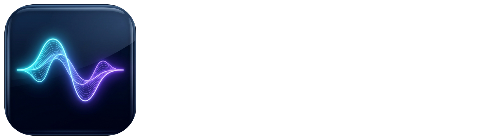
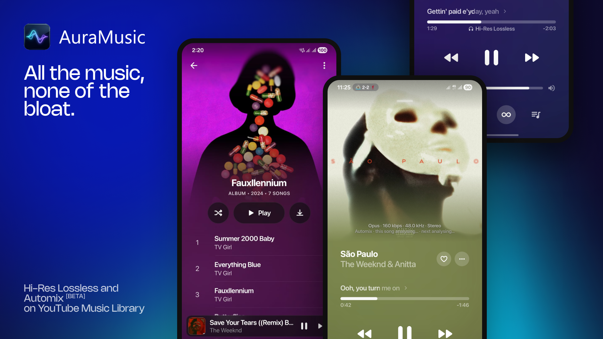

<div align="center">



# 🎵 AuraMusic

### The Aesthetic, Next-Generation Music Experience for Android, Desktop & Smart TVs
*Clean. Minimalist. Private. Powered by Kotlin Multiplatform & Compose.*

<br/>

[](https://github.com/likhith3035/Auramusic/releases)
[](https://github.com/likhith3035/Auramusic)
[](https://kotlinlang.org/)
[](LICENSE)

<br/>

[**📥 Download**](#download) • [**✨ Features**](#features) • [**📺 TV Experience**](#tv-experience) • [**🎨 Nothing OS Theme**](#nothing-os-aesthetic) • [**🛠️ Building**](#building) • [**⚖️ License**](#license)

<br/>

</div>

> [!NOTE]
> **AuraMusic** is an independent, open-source audio streaming client built with Kotlin & Compose Multiplatform. It delivers high-fidelity audio, frosted glassmorphic UI, smart sleep timers, dynamic lyrics, and seamless cross-device listening with zero tracking or clutter.

---

<div align="center">



</div>

## 🌟 Highlights & Key Features

<table>
  <tr>
    <td width="50%" valign="top">

### 🎧 Audio & Streaming Core
* **Endless Discovery**: Search, browse, and stream the vast YouTube Music library without ads or interruptions.
* **Lossless & Hi-Res Support**: FLAC / ALAC streaming with intelligent fallback.
* **Gapless Playback & Crossfade**: Smooth 0–12s transitions between tracks.
* **Automix Engine**: DJ-style beat-matched continuous transitions.
* **Offline Vault**: One-tap downloads with embedded high-res cover art and ID3 metadata.
* **Local Library Player**: Seamlessly scan and play your device's offline audio storage.

### 🌙 Smart Sleep Timer & Care
* **Smart Sleep Timer**: Countdowns by duration (minutes/hours) or song count (e.g., stop after 5 songs).
* **Non-Abrupt Stopping**: Never cuts off mid-chorus — finishes the current track smoothly before sleeping.
* **Inactivity Detection**: Detects stillness and eases volume down gently as you drift off.
* **Quick Pill Controls**: Directly accessible from the now-playing player bar.

    </td>
    <td width="50%" valign="top">

### 🎨 Visuals & Aesthetics
* **Nothing OS Mode**: Distinctive dot-matrix typography, monochrome surfaces, and luminous crimson accents.
* **Dynamic Ambient Canvas**: Glowing background mesh that real-time shifts with the album artwork palette.
* **Word-Synced Karaoke Lyrics**: Smooth syllable-level highlight animations.
* **Social Story Share**: Generate instant, Instagram-ready aesthetic music share cards.
* **Interactive Player Queue**: Rapid in-drawer song search and drag-to-reorder queue management.

### 🌐 Ecosystem & Sync
* **Google Account Login**: Sync your custom playlists, recommendations, and liked tracks.
* **Discord Rich Presence**: Live playback status, track progress, and album art on your Discord profile.
* **Scrobbling**: Native Last.fm and ListenBrainz integration.
* **Home Screen Widgets**: Audio visualizer waveforms, playback controls, and quick toggles.

    </td>
  </tr>
</table>

---

## 📺 Smart TV Architecture (Coming Soon)

AuraMusic is expanding beyond phones and desktops to the big screen:

```text
┌──────────────────────────────────────────────────────────────────┐
│  AuraMusic TV Engine (10-Foot Spatial Experience)               │
├─────────────────┬────────────────────────────────────────────────┤
│ 🎮 Remote D-Pad │ 100% directional focus (Up/Down/Left/Right/OK) │
│ 🖼️ Ambient Mode │ Full-screen OLED burn-in protection & visualizer│
│ 🎤 Big Lyrics   │ High-contrast living room karaoke display      │
│ 📱 QR Sync      │ Instant login from mobile app via 6-digit code │
└─────────────────┴────────────────────────────────────────────────┘
```

* **Samsung Tizen** (`.wgt`)
* **LG webOS** (`.ipk`)
* **Android TV / Google TV** (Sony, Vu, TCL, Xiaomi, Chromecast)
* **Amazon Fire TV**

---

<div align="center">

## 📥 Download & Installation

<a href="https://github.com/likhith3035/Auramusic/releases" target="_blank"></a>
<a href="https://github.com/likhith3035/Auramusic/releases" target="_blank"></a>

</div>

Get the latest build from the [**Releases Page**](https://github.com/likhith3035/Auramusic/releases):

| Package | Target | Description |
| :--- | :--- | :--- |
| `AuraMusic-vX.X-arm64.apk` | Modern Android Phones & Tablets | Optimized 64-bit build (Fastest, smallest size) |
| `AuraMusic-vX.X-Universal.apk` | All Android Devices & Emulators | Universal architecture compatibility |
| `AuraMusic-windows-portable.zip` | Windows 10 / 11 | Unzip and launch immediately (no install needed) |

---

## 🛠️ Building From Source

### Prerequisites
* JDK 17 or higher
* Android SDK (API 34+)
* Git

```bash
# 1. Clone the repository
git clone https://github.com/likhith3035/Auramusic.git
cd Auramusic

# 2. Build Android APK
./gradlew :app:assembleRelease

# 3. Run Desktop Application (Windows / Linux / macOS)
./gradlew :desktopApp:run
```

---

## 🤝 Acknowledgments & Upstream Credits

AuraMusic is maintained by **[@likhith3035](https://github.com/likhith3035)**.

* Built upon the foundational architecture of **BitChord** created by [@kushagrasinghx](https://github.com/kushagrasinghx).
* Heartfelt thanks to all open-source contributors in the Kotlin Multiplatform, Compose, and Media3 communities.

---

## ⚖️ License & Legal Disclaimer

* **License**: This project is open-source software licensed under the [**GNU General Public License v3.0 (GPLv3)**](LICENSE).
* **Disclaimer**: AuraMusic is an independent open-source audio client. It is **not** affiliated with, authorized, or endorsed by Google LLC, YouTube, or Spotify. All trademarks belong to their respective owners.

<div align="center">
  <sub>Crafted with precision for audiophiles and design enthusiasts.</sub>
</div>
