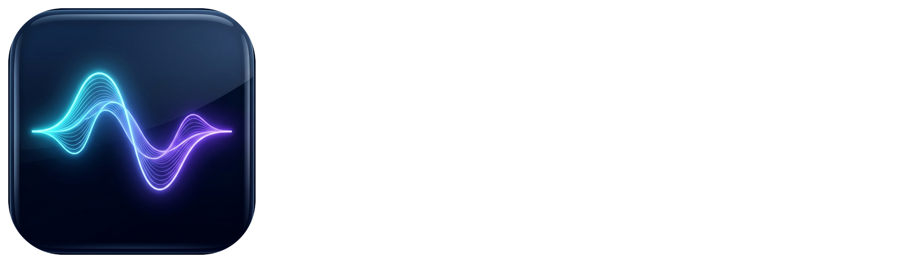
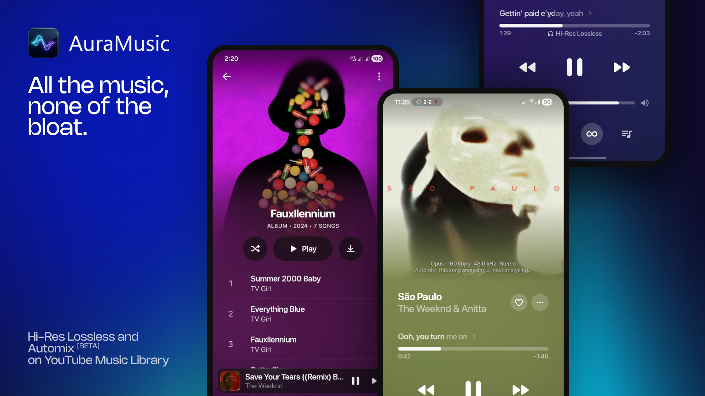

<div align="center">



# AuraMusic

### High-Performance, Bit-Perfect Audiophile and Video Streaming Client
*Clean. Private. Open Source. Powered by Kotlin Multiplatform and Compose Multiplatform for Android and Desktop.*

<br/>

[](https://github.com/likhith3035/Auramusic/releases)
[](https://github.com/likhith3035/Auramusic)
[](https://kotlinlang.org/)
[](LICENSE)
[](https://github.com/likhith3035/Auramusic/releases)

<br/>

[**Download**](#download--installation) • [**Comparison Matrix**](#how-auramusic-compares-with-other-apps) • [**Feature Tour**](#complete-feature-tour-explained-in-plain-english) • [**System Architecture**](#system-architecture) • [**Building**](#building-from-source) • [**Credits**](#developer--acknowledgments) • [**License**](#license--disclaimer)

<br/>

</div>

> [!NOTE]
> **AuraMusic** is a modern, independent, and private music and video streaming client built with Kotlin Multiplatform. It is designed for listeners who want pristine sound quality, fluid gesture controls, beautiful visuals, and complete freedom from advertisements and subscriptions.

---

<div align="center">



</div>

---

## Why AuraMusic?

Most music applications today force compromises on the listener:
* Streaming services compress sound quality, force subscriptions, and insert intrusive advertisements.
* Official video apps lock background audio behind paywalls or clutter your home screen with unwanted floating popup windows.
* Default phone audio drivers forcefully resample every song to 48 kHz, degrading the master recording quality before it reaches your headphones or USB DAC.

**AuraMusic solves all of this in a single, unified client.** It bypasses system sound restrictions to deliver bit-perfect audio directly to your hardware, integrates touch-friendly video gestures, automatically saves your mobile data, translates lyrics in real time, and runs on both Android phones and Desktop computers.

---

## How AuraMusic Compares with Other Apps

Here is an honest, side-by-side comparison between AuraMusic, popular commercial streaming platforms, and other open-source players:

| Feature & Capability | AuraMusic | Spotify Premium | YouTube Music (Official) | Apple Music | Other Open-Source Players |
| :--- | :---: | :---: | :---: | :---: | :---: |
| **Cost & Subscriptions** | **100% Free** | \$11.99 / month | \$10.99 / month | \$10.99 / month | 100% Free |
| **Advertisements & Trackers** | **Zero Ads, Zero Tracking** | Ad-Free (Paid Only) | Ad-Free (Paid Only) | Ad-Free (Paid Only) | Zero Ads, Zero Tracking |
| **Bit-Perfect USB DAC Direct Mode** | **Yes (Direct PCM Hardware)** | No (System Resampled) | No (System Resampled) | Mac/iOS Only | No (Android 48kHz Resampled) |
| **Studio Audio on Music Videos** | **Yes (320k/FLAC over Video)** | No Video Replacement | No (128kbps AAC Audio) | No | No |
| **Swipe Brightness & Volume Gestures** | **Yes (MX/VLC Style Gestures)**| No | No | No | No |
| **Pinch-to-Zoom Video (1.0x to 3.5x)** | **Yes (With Centroid Pan)** | No | Limited (Crop to Fill Only)| No | No |
| **Instant Romanized Lyrics (Romaji)** | **Yes (Japanese, Korean, Chinese)**| No | No | No | Rare |
| **Smart Cellular Data Auto-Switch** | **Yes (Auto-Steps Down to Audio)**| No | Limited (Audio-Only Toggle)| No | No |
| **Live Network Usage & Saved Data Telemetry**| **Yes (Live Byte Counters)** | No | No | No | No |
| **Background Audio Without Forced Popups**| **Yes (Pure Audio Backgrounding)** | Yes | Paid Only (Forces PiP) | Yes | Yes |
| **Native Multiplatform Desktop App** | **Yes (Windows, macOS, Linux)** | Yes (Heavy Electron) | Web App Only | Windows/macOS (Heavy) | Usually Android-Only |
| **Discord Rich Presence Integration** | **Yes (Shows Song & Progress)**| Yes | No | Plugin Required | Rare |
| **Account Requirement** | **Optional (Works Anonymously)** | Mandatory Account | Mandatory Account | Mandatory Account | Optional |
| **License** | **GPLv3 Open Source** | Proprietary Closed | Proprietary Closed | Proprietary Closed | Open Source |

---

## Complete Feature Tour (Explained in Plain English)

### 1. Studio Sound Quality & Signal Chain

* **Direct Hardware Audio (Bit-Perfect USB DAC)**:
  * Most Android phones forcefully resample all music to 48 kHz. This alters the musical timing and degrades high-resolution songs.
  * AuraMusic talks directly to your USB DAC or headphone amplifier using custom native drivers (`libusb` and `Oboe`). It bypasses Android's internal mixer completely, sending pure, uncompressed audio up to 192 kHz at 24-bit resolution.
* **Live Signal Inspector**:
  * Tap the signal chain indicator to see exact details about what you are hearing: the source audio format, sample rate, bit depth, and active audio output device.
* **High-Resolution Catalogue Ingestion**:
  * Automatically matches web streams with studio master recordings, upgrading your listening experience to high-bitrate Opus (160 kbps), AAC (256 kbps), or lossless FLAC.
* **DJ-Style Automix & Gapless Playback**:
  * Songs flow into one another with zero silence between tracks.
  * The built-in Automix engine analyzes beats per minute (BPM) and musical phrasing, allowing smooth crossfades between 0 and 12 seconds.
* **10-Band Graphic Equalizer**:
  * Fine-tune your sound with 10 frequency adjustment bands, custom presets, bass boost enhancement, and room reverb effects.
* **Offline Audio Vault & Local Storage Player**:
  * Download songs directly to your device with full album artwork and ID3 tags.
  * Scan and play songs already stored on your phone or SD card, supporting MP3, FLAC, WAV, M4A, OGG, and OPUS files.
* **Gentle Sleep Timer**:
  * Set a timer by minutes, hours, or number of songs.
  * Instead of cutting off abruptly mid-chorus, the sleep timer waits for the current song to finish playing smoothly before stopping playback.

---

### 2. Touchscreen Gesture Video Player

Watch music videos with the same fluid gestures found in premier media players like MX Player and VLC:

* **Left-Side Vertical Swipe (Brightness Control)**:
  * Slide your finger up or down on the left half of the screen to smoothly change display brightness from 0% to 100%. A sleek on-screen capsule shows the exact brightness percentage.
* **Right-Side Vertical Swipe (Volume Control)**:
  * Slide your finger up or down on the right half of the screen to adjust playback volume. Your device provides physical haptic vibration clicks on every 5% step so you feel the adjustment under your thumb.
* **Double-Tap Seek (-5s and +5s)**:
  * Double-tap the left side of the screen to jump back 5 seconds; double-tap the right side to jump forward 5 seconds.
  * Consecutive quick taps accumulate automatically (+5s, +10s, +15s, etc.) with an expanding ripple visual.
* **Two-Finger Pinch-to-Zoom (Up to 3.5x)**:
  * Pinch with two fingers to magnify the video from normal size up to 3.5x magnification.
  * Drag freely with your fingers to inspect background details, stage performances, or instruments.
* **Hold for 2.0x Fast-Forward**:
  * Press and hold anywhere on the screen for more than 300 milliseconds to instantly accelerate playback to 2.0x speed. Releasing your finger restores normal speed immediately.
* **Aspect Ratio Toggle `[ FILL ]` and `[ FIT ]`**:
  * Switch between letterboxed view and edge-to-edge crop with one tap, eliminating black side bars on modern ultra-wide smartphones (18:9, 19.5:9, and 21:9).
* **Touch Lock Mode `[ LOCK ]`**:
  * One-tap touch lock disables all on-screen gestures and buttons so accidental touches while lying in bed or walking will not interrupt your video. A floating `[ LOCKED - TAP TO UNLOCK ]` capsule lets you unlock whenever you are ready.
* **Clean Back Navigation**:
  * Pressing your phone's back button while watching a fullscreen video smoothly exits fullscreen mode rather than dropping you out of the player.

---

### 3. Audio-Video Fusion & Smart Sync

* **`[ HI-RES AUDIO OVER VIDEO ]` Mode**:
  * Online music videos often compress audio down to low-quality 128 kbps AAC.
  * When enabled, AuraMusic plays the high-definition video picture while seamlessly replacing the compressed video sound with a crystal-clear 320 kbps Opus or lossless FLAC studio recording, matched beat-for-beat to the video.
* **Pure Audio Backgrounding (No Forced Popups)**:
  * When you lock your phone screen, minimize the app, or switch to another task while watching a video, AuraMusic automatically shuts down the video decoder and releases screen resources to save battery.
  * The music keeps playing uninterrupted in the background.
  * Unlike other apps that force an annoying floating Picture-in-Picture (PiP) window onto your home screen, AuraMusic keeps your screen completely clean by default. You can still enable PiP popup video in Settings if you prefer a floating window.

---

### 4. Smart Mobile Data Saver & Live Network Telemetry

* **Automatic Wi-Fi to Cellular Stream Switching**:
  * High-definition video consumes massive amounts of mobile data.
  * When AuraMusic detects that your device has disconnected from Wi-Fi and switched to mobile cellular data during video playback, it automatically steps down from video to studio audio.
  * A top frosted notification banner informs you: `[ CELLULAR DETECTED: SWITCHED TO STUDIO AUDIO (SAVED ~40 MB) ]`.
* **Manual Override with 480p Data Cap**:
  * If you still want to watch the video on mobile data, simply tap `[ WATCH ANYWAY ]` on the banner. AuraMusic will cap the video resolution at 480p to prevent runaway data bills.
* **In-App Data Telemetry Dashboard**:
  * Visit Settings at any time to see an exact, live breakdown of cellular data used, Wi-Fi data used, audio vs. video splits, and total megabytes saved.

---

### 5. Synchronized Lyrics & Dynamic Romanization

* **Word and Syllable Karaoke Sync**:
  * Lyrics scroll automatically in time with the vocals, with smooth highlights for each word and line.
* **Dynamic Asian Script Romanization (Romaji)**:
  * Sing along to songs from across the world without needing to read foreign alphabets.
  * AuraMusic features an automatic phonetics engine that instantly transliterates Japanese (Kanji, Hiragana, Katakana) into Romaji, Korean (Hangul) into Romanized text, and Chinese (Hanzi) into Pinyin directly beneath the lyrics.
* **Multi-Provider Fallback & Time Offset Sliders**:
  * Automatically searches multiple lyrics databases (LRCLIB, Musixmatch, YouTube).
  * Includes a +/-500 millisecond slider so you can manually align lyrics that are slightly ahead of or behind the vocal track.

---

### 6. Living Visuals & Low-GPU 120 FPS Motion Design

* **Living Mesh Ambient Canvas**:
  * The player background continuously samples colors from the current album cover to produce a soft, kinetic ambient color gradient that shifts naturally as the music plays.
* **Aura Frosted Glass Surfaces**:
  * Translucent acrylic glass cards, rounded squircle corners, and deep obsidian backgrounds (`#0D0B14`) paired with electric indigo (`#6366F1`) and violet (`#8B5CF6`) accents.
* **Low-GPU 120 FPS Motion Engineering**:
  * Smooth cubic bezier deceleration curves (`CubicBezierEasing(0.2f, 0.0f, 0.0f, 1.0f)`) replace heavy spring physics.
  * In-flight shadow culling temporarily reduces shadow depth during animations, eliminating dropped frames and ensuring silky 120 Hz performance even on budget phones.

---

### 7. Multiplatform Desktop Experience (Windows, macOS, Linux)

AuraMusic provides a dedicated desktop client engineered specifically for larger displays:

* **Widescreen Multi-Column Interface**:
  * Collapsible sidebar navigation, spacious album grids, a persistent bottom playback bar, and an expandable queue drawer.
* **Bit-Perfect Desktop Audio Drivers**:
  * Supports Windows WASAPI Exclusive Mode and ASIO drivers, macOS CoreAudio, and Linux ALSA / PulseAudio for bit-perfect output on desktop DAC setups.
* **Keyboard Hotkeys**:
  * `Space`: Play or Pause
  * `J` / `L`: Seek backward or forward by 5 seconds
  * `Up` / `Down`: Volume up or down
  * `M`: Mute or unmute
  * `F`: Fullscreen player toggle
  * `Ctrl + F` / `Cmd + F`: Jump to search
* **Discord Rich Presence**:
  * Shows your friends what you are listening to on your Discord profile, including track title, artist name, album art cover, and live elapsed time bar.

---

### 8. Built-In In-App Auto-Updater

* Direct GitHub Releases integration checking `likhith3035/Auramusic`.
* Notifies you when a new version is available, presents release change logs, and lets you download updated APKs or portable desktop archives with one click.

---

## System Architecture

```text
+-------------------------------------------------------------------------------+
|                               AURAMUSIC CLIENT                                |
|          Kotlin Multiplatform (Kotlin 2.1) + Compose Multiplatform 1.7        |
+---------------------------------------+---------------------------------------+
|               ANDROID                 |                DESKTOP                |
|      (Phones, Tablets, Foldables)     |       (Windows, macOS, Linux)         |
+---------------------------------------+---------------------------------------+
| AUDIO SUBSYSTEM:                      | AUDIO SUBSYSTEM:                      |
| * AndroidX Media3 (ExoPlayer)         | * JVM Audio Pipeline / Java Sound     |
| * Bit-Perfect USB DAC Direct Bypass   | * WASAPI Exclusive / ASIO (Windows)   |
|   (Native libusb + Oboe engine)       | * CoreAudio (macOS) / ALSA (Linux)    |
| * 192 kHz / 24-bit Direct PCM         | * Bit-Perfect Output Mode             |
| * True Gapless + 0-12s DJ Automix     | * True Gapless Playback               |
+---------------------------------------+---------------------------------------+
| VIDEO & GESTURE SUBSYSTEM:            | DESKTOP INTEGRATION:                  |
| * Fullscreen Landscape Mode           | * Multi-Column Widescreen Layout      |
| * Left Vertical Swipe: Brightness HUD | * Discord Rich Presence (Discord RPC) |
| * Right Vertical Swipe: Volume + Tick | * System Media Transport Controls     |
| * Double-Tap Seek (+/-5s Ripples)     | * Global Keyboard Hotkeys             |
| * Two-Finger Pinch-to-Zoom (1x to 3.5x)|                                      |
| * Press & Hold for 2.0x Speed Boost   |                                      |
| * Touch Lock [ LOCK ] Mode            |                                      |
| * Hi-Res Studio Audio over Video Sync |                                      |
| * Audio-Only Backgrounding (No PiP)   |                                      |
+---------------------------------------+---------------------------------------+
| NETWORK & DATA ECONOMY:               | LYRICS & TRANSLATION ENGINE:          |
| * Live Cellular vs. Wi-Fi Byte Tracker| * Syllable Karaoke Sync Scrolling     |
| * Smart Cellular Video-to-Audio Switch| * Dynamic Asian Script Romanization   |
| * [ WATCH ANYWAY ] 480p Stream Capping|   (Japanese Romaji, Korean, Chinese)  |
| * In-App Data Usage Statistics        | * Multi-Backend Providers + Offset    |
+-------------------------------------------------------------------------------+
```

---

## Download & Installation

Visit the [**Releases Page**](https://github.com/likhith3035/Auramusic/releases) to download the latest release:

| Package File Name | Target Platform | Architecture | Download Size | Best For |
| :--- | :--- | :--- | :--- | :--- |
| **`AuraMusic-v3.2.0-arm64-v8a.apk`** | Android 8.0+ | `arm64-v8a` (64-bit) | ~136 MB | **Recommended for all modern phones.** Fast installation, lower storage use, and optimized performance for Snapdragon, MediaTek Dimensity, Google Tensor, and Exynos processors. |
| **`AuraMusic-v3.2.0-universal.apk`** | Android 8.0+ | Universal (All ABIs) | ~272 MB | **Universal compatibility.** Bundles all native slices (`arm64-v8a`, `armeabi-v7a`, `x86`, `x86_64`). Ideal for Android emulators, Intel Chromebooks, and older 32-bit hardware. |
| **`AuraMusic-3.2.0-windows-portable.zip`** | Windows 10 / 11 | `x86_64` (64-bit) | ~284 MB | **Standalone Windows distribution.** Comes with a bundled OpenJDK runtime environment. Extract the zip and run `AuraMusic.exe` directly without any installation steps. |

---

## Building from Source

### Prerequisites
* **JDK 17** or higher (Android Studio JBR or Eclipse Temurin OpenJDK)
* **Android SDK** with Platform Tools and API 34 Build-Tools
* **CMake 3.22+** and Android NDK (for native `libusb` and `oboe` audio drivers)
* **Git** command-line tools

### 1. Clone the Code Repository
```bash
git clone https://github.com/likhith3035/Auramusic.git
cd Auramusic
```

### 2. Build Android Application
```bash
# Build 64-bit ARM APK (Recommended)
./gradlew :app:assembleDevDebug

# Output APK files will be placed in:
# app/build/outputs/apk/dev/debug/AuraMusic-v3.2.0-arm64-v8a.apk
# app/build/outputs/apk/dev/debug/AuraMusic-v3.2.0-universal.apk
```

### 3. Build & Package Desktop Application
```bash
# Run desktop version in development mode
./gradlew :desktopApp:run

# Package standalone Windows portable distribution
./gradlew :desktopApp:windowsPortable

# Output zip archive will be placed in:
# desktopApp/build/distributions/AuraMusic-3.2.0-windows-portable.zip
```

---

## Developer & Acknowledgments

* **Lead Architect & Maintainer**: **Kami Likhith** ([@likhith3035](https://github.com/likhith3035))
  * Architecture of the Aura frosted glassmorphic UI, Bit-Perfect USB DAC bypass, touchscreen gesture video player, high-resolution audio over video synchronization, smart cellular data auto-switching, dynamic Romanized lyrics, and multiplatform desktop synchronization.
* **Upstream Foundation**: **BitChord** by [@kushagrasinghx](https://github.com/kushagrasinghx)
  * Foundational audio stream parsing and initial Compose Multiplatform scaffolding.
* **Open Source Ecosystem**:
  * Special thanks to the JetBrains Kotlin Multiplatform, Google AndroidX Media3, LibUSB, and Oboe developer communities.

---

## License & Disclaimer

* **Software License**: Distributed under the [**GNU General Public License v3.0 (GPLv3)**](LICENSE). You are free to inspect, modify, and distribute this software under the terms of the GPLv3 license.
* **Disclaimer**: AuraMusic is an independent open-source media player. It is not affiliated with, authorized, or endorsed by Google LLC, YouTube, Spotify, or Apple Inc. All album covers, artist names, song titles, and trademarks are the property of their respective copyright owners.

<div align="center">
  <sub>AuraMusic - Pure Sound. Fluid Gestures. Zero Compromises.</sub>
</div>
