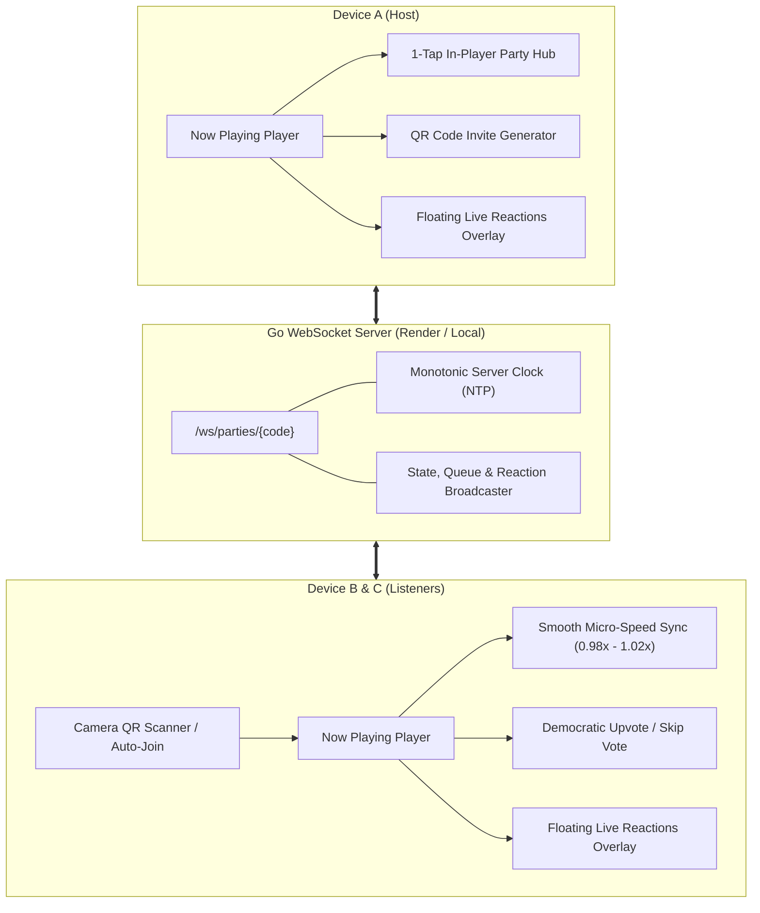

# Implementation Plan: Listen Together 2.0 (Social Jam)

> **Goal:** Transform **Listen Together** into a world-class, frictionless social listening experience (like Spotify Jam + Apple Music SharePlay) with direct player integration, live floating reactions, QR code joining, democratic jukebox voting, and smooth micro-pitch audio sync.

---

## 1. Problem Analysis & Current Pain Points

1. **Buried Navigation:** Currently, accessing party controls, chat, soundstage, and settings requires navigating away from the music player into `Settings -> Listen Together`. In `NowPlayingScreen`, there is only a minimal member drawer that kicks users to settings.
2. **Friction in Joining:** Users must manually type or copy-paste a 6-character code (`K7X9PQ`) or open a web link. There is no quick QR code display/scanner for in-person listening sessions.
3. **Disconnected Player Experience:** While listening in a party, the main Now Playing screen does not show who queued the track, does not render live floating emoji reactions over the album art, and hides participant presence.
4. **Harsh Playback Sync:** When a listener's connection buffers or drifts by a few hundred milliseconds, ExoPlayer jumps abruptly (seeking), causing audio pops and stuttering instead of smooth speed-ramping catch-up.
5. **Jukebox Democratic Control:** Queue reordering and upvoting are partially implemented in protocol models (`PartyModels.kt`) but lack an intuitive in-player voting interface.

---

## 2. Architecture & Design Blueprint

---

## 3. Phased Implementation Plan

### Phase 1: Frictionless Join & Share (QR Code & Quick Invite)
- **Objective:** Allow friends to join a party in 2 seconds without typing codes.
- **Tasks:**
  1. **QR Code Generator in `InviteSheet`:**
     - Render an SVG/Canvas QR code of the party invite link (`https://bitchord.kushagrasingh.in/invite/<code>` or `auramusic://party?code=<code>`) inside `ListenTogetherSheets.kt`.
  2. **Camera QR Scanner in `JoinPartySheet`:**
     - Add a "Scan QR Code" button that launches a CameraX QR scanner with instant join on detection.
  3. **Clipboard Auto-Detection:**
     - On opening the app or Listen Together screen, if the system clipboard holds a valid 6-character party code or link, show a subtle snackbar banner: *"Join party ABC123? [Join Now]"*.

### Phase 2: In-Player Social Jam (Now Playing Screen Integration)
- **Objective:** Bring the entire party experience directly onto the main music player.
- **Tasks:**
  1. **Live Presence Capsule on Now Playing Screen:**
     - In `NowPlayingScreen.kt`, render a sleek, animated pill below the album art showing:
       - Overlapping member avatars with active glowing rims.
       - "Queued by [Name]" attribution tag.
       - Tapping the capsule opens the new **Party Hub Drawer**.
  2. **Floating Real-Time Emoji Reactions (`AuraReactionSparks`):**
     - Floating reaction bar directly above player controls (❤️, 🔥, 🚀, 😭, ⚡, 🎉).
     - Tapping emits a reaction event via WebSocket; animated floating particles rise smoothly over the album art with sinusoidal drift and fade-out across all connected devices.
  3. **1-Tap Party Hub Bottom Sheet:**
     - Replace the basic `ListenTogetherMembersSheet` with an all-in-one in-player **Party Hub**:
       - Tab 1: **Live Jukebox Queue** (add tracks, upvote candidates).
       - Tab 2: **Party Chat & Soundboard** (quick text, airhorn, vinyl scratch, applause audio clips).
       - Tab 3: **Room & Host Controls** (pass the aux, host lock, audio sync calibration, leave).

### Phase 3: Democratic Jukebox & Collaborative Queue
- **Objective:** Give everyone a voice in what plays next.
- **Tasks:**
  1. **Democratic Upvoting (Song Requests):**
     - In the Jukebox Queue, each upcoming track has an Upvote counter (▲).
     - The track with the most upvotes automatically rises to the top of the next-to-play order.
  2. **Room Vote to Skip:**
     - Add a "Vote to Skip" button on the player when listening in a party.
     - Displays live progress (e.g., `2/3 votes to skip`). When threshold is met, the host/server automatically skips to the next track.
  3. **"Pass the Aux" (Auxiliary DJ Mode):**
     - The host can tap any member in the party and toggle **"Give Aux Cord"**, allowing that friend full playback and queue control without losing ownership.

### Phase 4: Audio Synchronization & Drift Smoothing
- **Objective:** Eliminate harsh audio seeking and stuttering during playback catch-up.
- **Tasks:**
  1. **Smooth Micro-Speed Catch-Up:**
     - In `PlaybackService.kt`, instead of calling `player.seekTo()` when drift is under 1.5 seconds:
     - If listener is behind by 100ms–1500ms, set `player.setPlaybackSpeed(1.025f)` until playhead aligns, then restore to `1.0f`.
     - If listener is ahead, set `player.setPlaybackSpeed(0.975f)` until aligned.
     - Only perform hard seeks for major skips (> 1.5s) or song changes.
  2. **Bluetooth Latency Preset Calibration:**
     - Quick 1-tap presets in the sync calibration group:
       - *Phone Speaker / Wired (0 ms)*
       - *TWS Earbuds (+180 ms)*
       - *Car Audio / Bluetooth Speaker (+250 ms)*

### Phase 5: Session Recap & Playlist Export
- **Objective:** Preserve memories after the party ends.
- **Tasks:**
  1. **Party Recap Hologram Dialog:**
     - When leaving the party or after party ends:
       - Total session duration and total tracks played.
       - "MVP DJ" (member who queued the most played tracks).
       - Top voted songs.
       - 1-tap **"Save to Library as Playlist"** button.

---

## 4. Verification & Testing Plan

1. **Protocol & State Unit Tests (`shared:jvmTest`):**
   - Test `PartyQueue` upvoting and sorting algorithms.
   - Test micro-speed drift calculation in `ListenTogetherTest`.
2. **Local Multi-Device / Emulator Testing:**
   - Run local backend with `go run backend/main.go` or connect to Render cloud.
   - Run two instances (connected phone + emulator / second device).
   - Verify QR code scanning and instant join.
   - Verify floating reactions propagate in real time with < 100ms latency.
   - Verify micro-pitch speed ramping catches up smoothly without audio pops.
